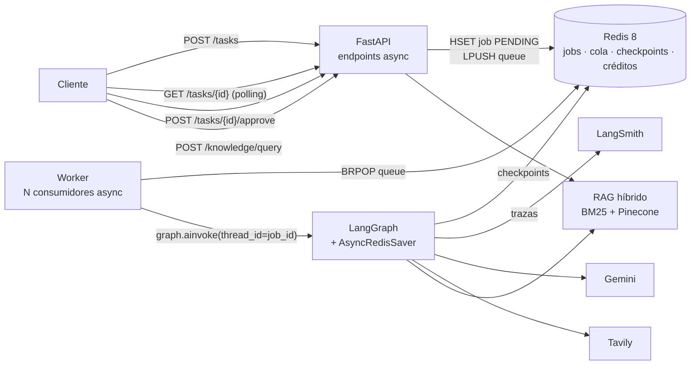
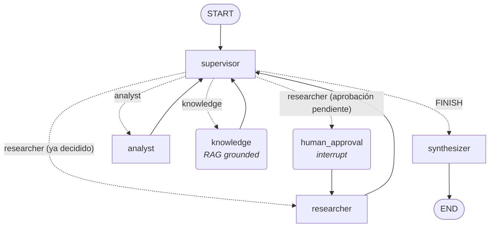

# The Intelligence System

Entrega final — AI Engineer (Coderhouse). Sistema de IA de grado de producción que combina:

- **RAG híbrido** (BM25 + Pinecone semántico) sobre documentación técnica, con generación *grounded*
  ("No lo sé" si la respuesta no está en los documentos).
- **Agentes con Supervisor** (LangGraph): un Supervisor deriva cada paso a **knowledge** (RAG), **researcher**
  (web) o **analyst** (cálculo/estadística/sentimiento), valida con una rúbrica y cierra con una síntesis.
- **API REST async** (FastAPI) que no bloquea nunca el event loop: cola en Redis, **checkpointer de
  LangGraph** (`AsyncRedisSaver`) para que las conversaciones sobrevivan a un restart, y un gate
  **Human-in-the-loop** antes de gastar créditos en búsquedas pagas.
- **Trazabilidad completa** en LangSmith: cada ejecución queda como una traza navegable, con costo, tokens
  y latencia por nodo del grafo.

Se ensambla a partir de tres pre-entregas: el orquestador multi-agente (M6), su versión async con API/HITL/
observabilidad (M7), y un módulo de RAG híbrido de una entrega anterior — integrado acá como un tercer
especialista del Supervisor.

## Arquitectura



### El grafo del Supervisor



(Este mismo diagrama se puede pedir en vivo con `GET /graph`.)

**Cómo elige el Supervisor:** preguntas sobre la documentación técnica indexada (Google ADK) van a
`knowledge`; hechos externos/actuales van a `researcher` (Tavily); cálculos, estadística y sentimiento van a
`analyst`. `knowledge` no es un agente ReAct con tool-loop: llama directo a la cadena RAG (retrieve +
generación grounded, ya validada con Pydantic), igual que `synthesizer` llama al LLM directo.

### Ciclo de vida de un job

```
PENDING ──worker──> RUNNING ──┬──> DONE
                              ├──> FAILED              (excepción · timeout · worker caído)
                              └──> AWAITING_APPROVAL ──POST /approve──> PENDING ──> RUNNING ──> ...
```

## Estructura

```
intelligence-system/
├── app/
│   ├── main.py                     # FastAPI: /tasks · /tasks/{id} · /tasks/{id}/approve ·
│   │                                #          /knowledge/query · /health · /graph
│   ├── config.py                   # Settings (infra: Redis, worker, HITL, Tavily) — env vars, sin hardcoding
│   ├── graph.py                    # ensambla el grafo del Supervisor + AsyncRedisSaver (thread_id = job_id)
│   ├── jobs.py · redis_client.py · worker.py · observability.py · hitl.py
│   ├── orchestrator/
│   │   ├── state.py                # estado compartido (OrchestratorState) + trazabilidad append-only
│   │   ├── llm.py                  # Gemini async + fallback entre modelos
│   │   ├── agents/                 # supervisor (+ synthesizer), researcher, analyst, knowledge
│   │   ├── tools/                  # web_search (Tavily + créditos), mock_search, calculator, stats, sentimiento
│   │   └── data/mock_corpus.json   # corpus local para mock_search
│   └── rag/                        # módulo RAG (config, setup_index, ingest, retriever, metrics, evaluate,
│       └── ...                     # rag.py con get_rag_response, startup.py con ensure_index_ready)
├── data/rag/                       # PDFs de la documentación de Google ADK + categories.json + golden_set.json
├── scripts/                        # load_test.py (5 escenarios) · langsmith_report.py
├── tests/                          # test_flow.py (HITL/jobs) · test_ingest/metrics/retriever/evaluate.py (RAG)
├── screenshots/                    # evidencia de las corridas (load_test_results.json, langsmith_report.txt)
├── docker-compose.yml · Dockerfile · requirements.txt · .env.example · run.sh
```

## Cómo levantarlo (un solo comando)

### Requisitos

- Docker y Docker Compose.
- Keys de `GOOGLE_API_KEY` (Gemini) y `PINECONE_API_KEY` (Pinecone) — **obligatorias**: a diferencia de
  `TAVILY_API_KEY` (opcional, degrada a `mock_search`), sin estas dos el sistema no levanta, porque el RAG
  es un pilar central de esta entrega. `LANGSMITH_API_KEY` es necesaria para ver las trazas.

```bash
cp .env.example .env     # completar las keys
docker compose up --build
# o, equivalente:
./run.sh
```

La primera vez, la API detecta que el namespace de Pinecone no tiene (o no tiene localmente) los chunks
indexados y corre la ingesta automáticamente al arrancar (`app/rag/startup.py`) — no hace falta un paso
manual. Arranques siguientes la detectan ya indexada y no reingesta.

Swagger en <http://localhost:8000/docs>. Chequeo rápido: `GET /health`.

```bash
docker compose up --build --scale worker=2   # más workers consumiendo la misma cola
```

## Uso de la API

```bash
# RAG directo, sin pasar por el grafo de agentes
curl -X POST localhost:8000/knowledge/query -H "Content-Type: application/json" \
  -d '{"question": "How do I run my ADK agent as a REST API?"}'
# {"respuesta": "To run your agent as a REST API service, use `adk api_server`...",
#  "referencias": ["T-DEVAGENT-I-m3-l0-en-file-4.en.pdf p.3"]}

# Tarea para el equipo de agentes: responde 202 enseguida
curl -X POST localhost:8000/tasks -H "Content-Type: application/json" \
  -d '{"query": "¿Cuál es la tasa de política monetaria actual del Banco Central de Chile y cuánto rinde 1.000.000 CLP en un año?", "max_steps": 8}'
# {"job_id": "c6f5...", "status": "PENDING", "links": {...}}

# Polling
curl localhost:8000/tasks/<job_id>
# status=AWAITING_APPROVAL -> trae approval_request (ver sección HITL)

# Aprobación humana (o {"approved": false} para no usar búsqueda paga)
curl -X POST localhost:8000/tasks/<job_id>/approve -H "Content-Type: application/json" \
  -d '{"approved": true, "reviewer": "franco", "comment": "ok gastar créditos"}'

curl "localhost:8000/tasks/<job_id>?events=true"   # polling hasta DONE: result, decisions, contributions...
```

## Human-in-the-loop

**Qué es crítico:** las búsquedas en Tavily cuestan créditos de una cuenta con presupuesto limitado (1500).
La primera vez que el Supervisor deriva al `researcher`, la arista pasa por el nodo `human_approval`, que:

1. Estima el costo (`TAVILY_MAX_SEARCHES_PER_RUN` × 1 crédito) y lo compara con `HITL_AUTO_APPROVE_MAX_CREDITS`
   (default 0, o sea que siempre pide aprobación).
2. Si hace falta aprobación, llama a `interrupt(payload)`. El checkpoint queda en Redis y el worker marca el
   job `AWAITING_APPROVAL`, exponiendo el `approval_request` en `GET /tasks/{id}`. **El worker queda libre**:
   no hay ninguna corrutina esperando.
3. `POST /tasks/{id}/approve` hace la transición atómica `AWAITING_APPROVAL → PENDING` (una segunda
   aprobación devuelve 409) y reencola el job con `action=resume`.
4. El worker reanuda el **mismo thread** con `Command(resume=decision)` — puede ser otro proceso, o la API
   después de un reinicio, porque el estado está en Redis.
5. **Si se aprueba**, el `researcher` usa Tavily. **Si se rechaza**, se construye **sin** `web_search` — lo
   impone el código, no el prompt.

El agente `knowledge` (RAG) **no** pasa por este gate: no tiene un costo variable por llamada que lo
justifique (Pinecone/embeddings no se miden en un presupuesto manual como Tavily).

Sin `TAVILY_API_KEY` no hay costo y el gate deja pasar sin preguntar (`search_approval=not_required`).

## RAG híbrido (agente `knowledge`)

- **Base vectorial:** Pinecone Serverless (índice `hybrid-rag`, namespace `docs`, métrica coseno).
- **Embeddings:** `multilingual-e5-large` (1024 dim) vía Pinecone Inference.
- **Búsqueda léxica:** BM25 en memoria (`rank-bm25`), con `EnsembleRetriever` de LangChain (Reciprocal Rank
  Fusion) para combinarla con la semántica.
- **Generación grounded:** una cadena LCEL (`retrieve | format_docs → prompt → Gemini → PydanticOutputParser`)
  responde **solo** con lo que está en el contexto recuperado; si no está, responde `"No lo sé"` con
  referencias vacías. Salida tipada con Pydantic (`RAGResponse: respuesta, referencias`).
- **Corpus:** 4 PDFs de documentación técnica de Google ADK (`data/rag/`), categorizados en
  `categories.json`, evaluados contra un golden set de 5 preguntas (`golden_set.json`,
  `python -m app.rag.evaluate`).
- **Ingesta:** `python -m app.rag.ingest` (o automática al arrancar la API). Es idempotente: si el
  namespace ya tiene vectores y los chunks ya están persistidos localmente, no reindexa; con `--force`
  reindexa todo.

## Persistencia en Redis

| Clave | Tipo | Contenido |
|---|---|---|
| `intelligence:job:<id>` | HASH | status, query, result, error, approval_request, decisions, contributions, trace, timings |
| `intelligence:job:<id>:events` | LIST | historial de transiciones |
| `intelligence:jobs` | ZSET | índice por fecha (para `GET /tasks` y el reaper) |
| `intelligence:queue` | LIST | cola de trabajo (`LPUSH` / `BRPOP`) |
| `intelligence:tavily:*` | STRING | créditos usados (global), búsquedas por job y caché de resultados |
| `checkpoint:*` | JSON | checkpoints de LangGraph (`AsyncRedisSaver`, TTL 7 días) |

**Manejo de errores:** si el grafo falla en background, el worker captura la excepción y deja el job en
`FAILED` con `error` y `error_detail`. El cliente siempre llega a un estado terminal (`terminal: true`).
También terminan en `FAILED`: un timeout por ejecución (`JOB_TIMEOUT_SECONDS`), un worker detenido a mitad
de un job, o un job `RUNNING` sin actividad porque murió el proceso (lo detecta el **reaper**).

## Observabilidad (LangSmith)

`LANGSMITH_TRACING=true` alcanza para que LangGraph y LangChain tracen todo: nodos del Supervisor,
sub-agentes ReAct, tools, la cadena RAG y las llamadas a Gemini con tokens de entrada/salida. Cada ejecución
es una traza raíz con su propio `run_id` (guardado en el job), agrupada por `thread_id` para que el arranque
y la reanudación del HITL queden juntos en la vista *Threads*.

### Corrida de validación (2026-11-21, Docker Compose, 5 escenarios concurrentes)

Dispara los 5 escenarios con `python scripts/load_test.py` (cubren `knowledge` puro, `knowledge`+
`researcher`, `researcher`+`analyst` con HITL aprobado, con HITL rechazado, y el fallback de `knowledge`
→`researcher` cuando el RAG responde "No lo sé"). Salidas completas en
[screenshots/load_test_results.json](screenshots/load_test_results.json) y
[screenshots/langsmith_report.txt](screenshots/langsmith_report.txt) (generado con
`python scripts/langsmith_report.py`, que lee los mismos runs vía la API de LangSmith).

| Métrica | Valor |
|---|---|
| Jobs | 5/5 DONE, 0 FAILED |
| Tiempo de encolado (`POST /tasks`) | 8–46 ms (p95 39 ms) |
| Paralelismo | 566 s de trabajo sumado en 238 s de reloj |
| Costo por ejecución (LangSmith) | 0,0293 USD de media (0,012–0,067) · 0,146 USD en total |
| Latencia por job (arranque + reanudación) | p50 56,3 s · p95 224,4 s |

**Tokens por nodo del grafo:** `researcher` 44 % (reenvía los extractos de Tavily en cada vuelta del ReAct),
`supervisor` 28 %, **`knowledge` 14 %** (3 llamadas: retrieve + generación grounded), `synthesizer` 10 %,
`analyst` 4 %.

**Lectura de la corrida:** con 5 jobs concurrentes sobre el free tier de Gemini aparecieron varios 429/503
(mismo patrón que en la pre-entrega 7); el fallback entre modelos los absorbió sin que ningún job terminara
en `FAILED`. El nodo `knowledge` quedó claramente discriminado del resto en las trazas, lo que confirma que
la integración del RAG en el grafo es trazable igual que los demás especialistas.

> Las capturas visuales del dashboard (lista de trazas, árbol por nodo, costo/latencia) se agregan a mano en
> `screenshots/` desde <https://smith.langchain.com> (proyecto `intelligence-system`) — este README ya
> incluye la evidencia numérica equivalente, leída de la misma API.

## Tests

```bash
docker run -d -p 6379:6379 redis:8.2-alpine   # o el redis del docker-compose
pip install -r requirements.txt
pytest -q
```

26/26 OK. Usan Redis real, `AsyncRedisSaver` real e `interrupt`/`resume` reales (con los agentes
reemplazados por stubs) para `test_flow.py`; los tests de RAG (`test_ingest`, `test_metrics`,
`test_retriever`, `test_evaluate`) son puros/con fixtures y no llaman a ninguna API externa.

## Errores comunes y cómo se evitan

| Error | Solución |
|---|---|
| Hard-coding de ids/modelos | Todo vía `.env` / `app/config.py` / `app/rag/config.py` — índice de Pinecone, modelos de Gemini, presupuestos, todo configurable sin tocar código. |
| Mezclar sync dentro de `async def` | Endpoints y el grafo son async de punta a punta (Gemini, Tavily, Redis). La única pieza síncrona de propósito (la ingesta a Pinecone, con I/O de archivos y red) se corre con `asyncio.to_thread` desde el lifespan, nunca bloqueando el event loop. |
| Caja negra sin trazas | LangSmith activado por default; los 5 escenarios de validación quedan documentados arriba con costo/tokens/latencia por nodo, incluyendo el nuevo agente `knowledge`. |
| Excepciones silenciosas en background | `try/except` en el worker → `FAILED` con detalle. Timeout por job y reaper para jobs huérfanos. |
| Carreras con jobs concurrentes | Transiciones de estado con Lua (compare-and-set). El guardián de créditos de Tavily es atómico en Redis. |
| Sub-agentes heredando el checkpointer | Los agentes ReAct internos (`researcher`, `analyst`) se compilan con `checkpointer=False`: solo el grafo padre persiste en Redis. |
| RAG alucinando fuera de su corpus | La cadena RAG responde `"No lo sé"` si la respuesta no está en el contexto recuperado (prompt + validación Pydantic), y el Supervisor respeta esa limitación (rúbrica R6) en vez de inventar. |

## Stack

FastAPI · LangGraph 1.2 · langgraph-checkpoint-redis · Redis 8 · LangSmith · Gemini (langchain-google-genai) ·
Tavily · Pinecone (langchain-pinecone) · BM25 (rank-bm25) + `EnsembleRetriever` · Pydantic · httpx · pytest
